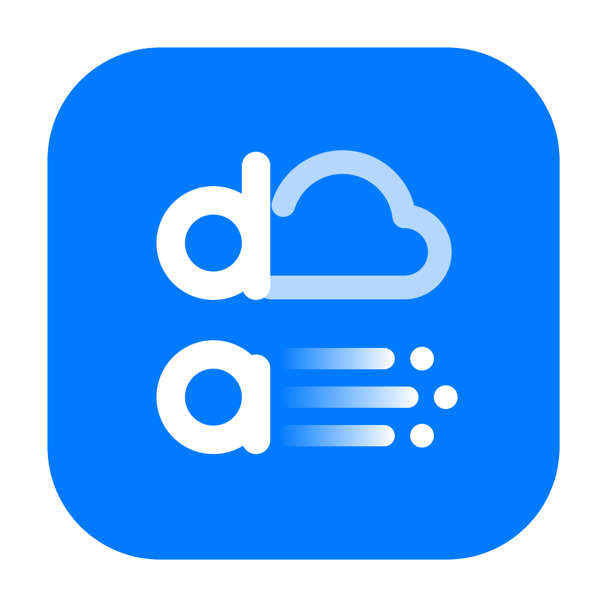
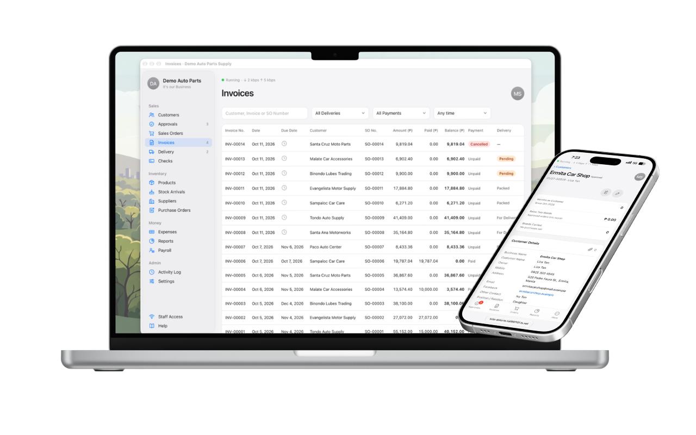

<h1 align="center">Distribution App</h1>

<b>Run Your Whole Distribution Business From One App — Orders, Deliveries, Collections, Stock, and Books.</b> Made for Philippine distributors. Runs on your own office computer — <b>no internet needed</b>. One flat price for your whole team.

Shown in Demo Mode. All stores, people, addresses, part numbers, and prices are made up. Brand names belong to their owners and appear only as examples — we are not affiliated with them.

&nbsp;&nbsp;

## From Order to Collection — In One Place

Your salesman takes the order on their phone. You approve it with one tap — the invoice is created and the stock is taken out for you. The warehouse packs it, the driver marks it delivered, and the payment terms start counting by themselves. When the customer pays — cash, bank, GCash, Maya, or a post-dated check — you record it, and your reports, receivables, and books are already up to date.

**No spreadsheets. No copying. No "who has the latest file?"**

## Who It's For

Distributors and wholesalers with **2 to 20 people** — an owner, a few salesmen, someone in the office, a warehouse, a driver. Auto parts, lubricants, hardware, grocery and FMCG, pharma, school and office supplies — if you sell to stores on credit and deliver, it's made for you.

## Why It's the Best Choice

| | **Distribution App** | Cloud Apps | Spreadsheets |
| :--- | :---: | :---: | :---: |
| **10 users** | $39/mo flat | Per user | Free |
| **No internet** | Keeps working | Stops | Keeps working |
| **Your data** | Your office | Their server | Loose files |
| **Post-dated checks** | Built in | Rarely | By hand |
| **BIR, SSS, PhilHealth** | Built in | Varies | By hand |
| **Orders without signal** | Yes | Rarely | Paper slips |
| **Approvals** | One tap | Varies | Phone calls |
| **Change history** | Locked log | Varies | None |
| **Setup** | An afternoon | Weeks | — |

## Why Distributors Love It

- **No Per-User Fees.** One flat price for the whole company — add your salesman, your warehouse, and your driver without paying more for each one.
- **Works Even When the Internet Is Down.** It runs on your own office computer. Salesmen can even take orders with no signal — they're sent automatically when the phone is back online.
- **Your Data Stays with You.** Everything is stored on your own office computer — no cloud, no monthly server fee, nothing is sent to us. Staff simply connect over your office Wi-Fi.
- **Made for How Business Is Done Here.** Post-dated checks, credit limits and holds, customer discounts off SRP, BIR tax estimates, SSS / PhilHealth / Pag-IBIG payroll, GCash, and Maya.
- **Safe.** Every user has their own login and only the permissions you give them. Every change is written to an activity log that nobody can edit — not even an admin. Wrong passwords lock the account for a few minutes. A backup is made every day and every time the app quits. The page blurs when a computer is left alone. The Mac app is signed and notarized by Apple.
- **Fast.** One small program, no installation of databases or servers. Pages open in a few milliseconds and travel compressed to phones, even with a year of data (tested with 1,000 customers and 15,000 sales orders), and it runs well on an older, low-cost computer.
- **Beautiful and Easy for Your Team.** A clean, minimal design on computers and phones, Dark Mode, and accessibility for every user. Staff open it in the browser on any computer or phone — nothing to install on their devices.

## Little Things That Save Hours

- **Business Cards in One Click** — Every staff member downloads their own clean, professional card, ready to print or share as an image.
- **Customer Forms That Fill Themselves** — Print a Customer Information Sheet on your letterhead, then upload the filled-in PDF and the new customer's details are typed in for you.
- **Price Lists in Seconds** — Pick your brands and get a neat A4 price list with your contact details. Got a supplier's price list? Import it from PDF, Excel, or CSV.
- **Smart Purchase Orders** — The app suggests what to reorder from your actual sales, supplier lead times, and minimum orders, and tells you how many days of stock you have left.
- **Approvals That Find You** — A soft chime when an order or new customer needs your OK, on any device.
- **Books That Do Themselves** — Income Statement, Balance Sheet, Trial Balance, and General Ledger are worked out from your invoices, payments, stock, and expenses. Send your bookkeeper one CSV.
- **An App on Every Phone** — Add it to the Home Screen and it opens like a real app, even without signal.

## Add-ons and Options

Everything above works on your office Wi-Fi, with **no internet at all**. These are extras for businesses that want them — switch them on in **Settings → Features**. All are **included free in the 15-day trial**, so you can try them before you decide.

- **Work From Anywhere** Optional — Let staff use the app outside the office too: salesmen on the road, you at home. Turn on **Remote Access** with one button (it uses Tailscale, free for small teams); the app stays private and is never open to the public internet. It needs internet on both ends — but if the connection drops, **the office keeps working**, and salesmen's phones keep new orders and send them once they're back online.

- **Salesman Locations (Visits)** Beta — Uses the salesmen's phones over Work From Anywhere. Salesmen **Check In** at each customer, and the **Visits** page shows **where each sales order and payment was made and how far from the store**. Need to know where someone is? **Ping** them — with an optional message like *"Pls proceed to Tondo Auto Supply"* — and a pop-up on their phone lets them share their location with one tap. Each salesman agrees once, nothing is tracked in the background, and every request is logged — made with the Data Privacy Act in mind.
- **Payment QR Code** Beta — Upload your GCash or QR Ph code once. Every salesman can show it on their phone or send it as an image or PDF, with a clear reminder printed on it: **salesmen don't accept cash** — checks or QR only, and always ask for an official receipt.
- **Signed Delivery Receipts** — Drivers snap a photo of the signed delivery receipt (or attach a PDF) right on the Delivery page, so you have proof of every delivery, kept with the invoice.

**Each add-on is paid for separately** — Payment QR Code, Salesman Locations, and Signed Delivery Receipts — so you pay only for the ones you use. They are unlocked with your activation code — **ask us for pricing**. Work From Anywhere is included.

## What It Does

- **Sales** — Customers with credit terms, limits, and discounts, sales orders with approval, automatic invoices, delivery tracking (Packed → For Delivery → Delivered), Delivery Receipts, payments, post-dated checks, credit memos, and statements of account.
- **Inventory** — Products in units and cases, stock arrivals with average cost, suggested purchase orders, price list import (PDF, Excel, or CSV), stock adjustments, and days of stock left.
- **Money** — Receivables and payables by age, supplier payments, expenses, a 4-week cash forecast, BIR tax estimates and payments, and payroll with government contributions and payslips.
- **Accounting** — Income Statement, Balance Sheet, Trial Balance, General Journal, and General Ledger, worked out automatically from your sales, payments, stock, and expenses — nothing to enter twice.
- **Reports** — Sales by supplier, brand, product, or customer, collection forecast, salesman performance, and CSV export.
- **Printouts** — A4 Sales Invoice, Sales Order, Delivery Receipt, Statement of Account, Price List, and Business Cards.
- **Your Team** — Roles for Admin, Staff, Salesman, and Delivery; permissions down to each report and whether someone sees cost or profit; an activity log nobody can edit.
- **Everyday Comfort** — Approvals with a chime, credit holds for overdue customers, Dark Mode, per-person accessibility settings, a clean layout on phones, and one-click updates.

| Your Computer | Download This File |
| :---: | :---: |
| Mac | `DistributionApp-<version>-mac.zip` |
| Windows | `DistributionApp-<version>-windows.zip` |

---

## Changelog

### Version 1.4.0 (Build 32) — Current · October 14, 2026

> Tested on Mac and Windows. The Mac version is notarized by Apple.

- **Subscribe Online** — Paste the license key from your receipt email in **License**. Activation codes keep working.
- **Payments Page** — Receive one payment for several invoices (oldest first), with optional deductions — Wrong Pricing, Support, or Withholding Tax — plus a reference and an attached slip.
- **Acknowledgment Receipts and In-house Debit Memos** for every payment and deduction.
- **Down Payments and Deposits** — Record money paid in advance, use it on invoices later, or refund it.
- **Customer and Supplier Ledgers** — Every bill, payment, and credit in one running balance.
- **Stock Count** — Count many products at once in cases and pieces; one tap corrects the stock.
- **Backups Kept Off the Computer** — Also copied to a USB drive or your Google Drive, OneDrive, or Dropbox folder.
- **A Start Page for Each Person**, and **Review Permissions** — every permission for every user on one sheet.
- **Demo Always Open** — Explore the Demo Company anytime, even after your free trial ends.

[Full list of changes →](../../releases/tag/v1.4.0-build32)

### Version 1.3.0 (Build 31) — October 11, 2026

- **Proof of Order** — Salesmen attach the customer's signed PO or a photo of the order. Turn on **Require Proof of Order** and no order goes for approval without one.
- **Your Own Terms on Every Form** — Type `{customer terms}` and each invoice, sales order, and statement fills in that customer's payment terms. Leave it blank and nothing is printed.
- **Salesman Locations** and **Payment QR Code** add-ons Beta.
- **MariBank and Atome** payments.
- **Desktop Notifications** — Approvals arrive with your computer's own alert sound.
- **Your Updates Date at a Glance** — License shows **Updates and Support · Until …**, and the app offers **Renew** instead of installing a version your plan doesn't include.
- **Smarter Phones** — *Connecting…* instead of "offline" on a slow start, approval chimes again, and bigger, easier-to-tap buttons.
- **Even Cleaner Design** — Simple on/off switches, every title the same size, and descriptions below the content.

[Full list of changes →](../../releases/tag/v1.3.0-build31)

### Version 1.2.0 (Build 30) — October 10, 2026

- **Offline Salesman Orders** — No signal? The order waits on the phone and sends itself later.
- **Remote Access** — A secure address for staff phones, turned on with one button, with a QR code.
- **Opens Without Signal** — The Home Screen app shows its start page even offline.
- **Delivery Receipt Switch** on invoices; drivers can print the Delivery Receipt.
- **Staff Access Redesigned**, a new phone tab bar for approvers, and many phone and desktop improvements.

[Full list of changes →](../../releases/tag/v1.2.0-build30)

---

## Questions Owners Ask

**What if the office computer breaks?**
A backup is saved every day and every time the app quits, and each backup can also be copied by itself to a USB drive or your Google Drive, OneDrive, or Dropbox folder — restoring it on a new computer brings everything back.

**Do I need internet?**
No. Staff in the office connect over your Wi-Fi. Internet is only needed for staff outside the office (through Remote Access), for update checks, and for activation.

**Can I see everything from my phone?**
Yes — on your office Wi-Fi, open it in your phone's browser and add it to your Home Screen; it opens like an app. Want it outside the office too? Turn on **Work From Anywhere**.

**What if I stop subscribing?**
Your data stays on your computer. The app turns read-only, so you can still open and print everything, and subscribing again picks up right where you left off.

**Is it BIR-accredited?**
No. It is not a registered Computerized Accounting System. Tax figures are estimates to help you prepare — please have your accountant check them before filing. Ask your RDO what applies to your business.

**Can I try it first?**
Yes — a free 15-day trial with up to 20 users and every add-on, plus a **Demo Mode** filled with sample customers, products, and orders so you can explore without typing anything. Everything in the demo is made up — no real stores, people, or prices.

**How do I move from my old system or spreadsheets?**
Import your price lists from PDF, Excel, or CSV in minutes, and add customers by uploading their filled-in information sheet. Optional setup help is available — we'll do it with you.

## User Guide

The **[Distribution App User Guide](https://totoantonio.pages.dev/distribution/userguide/)** walks you through everything, one task per page:

- **Getting Started** — install on Mac or Windows, try the demo, set up your company, connect your staff
- **Selling, Collecting, Buying and Stock, Money and Books, Settings** — every page explained step by step
- **How It All Connects** — live diagrams you can drag around to see how orders, payments and stock flow into your books
- **Troubleshooting** — quick fixes for common questions

Works on any computer or phone, in Light and Dark Mode.

## Need Help?

Email **alfiesuperhalk@<!-- -->gmail.com**

Copyright © 2026 totoantonio
